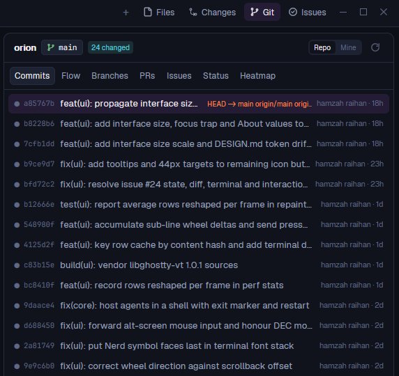

# Git tab

A git + GitHub workspace pane for Herdr: history, branch flow, branches, pull requests, issues,
the working tree, and a contribution heatmap in one panel. It follows the active space's focused
terminal folder and runs git/gh on that machine, so a remote space reads the remote repository.
The panel body starts below Herdr's tab bar and ends above its status bar. Open it from a
workspace right-click ("Open Git Tab") or dock it as a side panel in a cloned layout.

## What you see

One column on the `canvas` color. Top to bottom:

- **Header**, 42px tall, with a tab strip (Commits, Flow, Branches, PRs, Issues, Status, Heatmap).
  The active tab is `selected`/`foreground`; others `muted`; both get `hover` under the pointer.
  A scope chip (`repo`/`mine`) and a refresh control sit to the right.
- **Commits** (`git log --graph` across all branches, last 100): hash, subject, refs, author,
  age; rows 28px tall with a `●`/`◆` merge marker.
- **Flow**: one lane per branch, trunk first; merge commits as diamonds, ahead/behind, PR number,
  `merged → main`.
- **Branches**: `git branch -vv --all`, current marker, upstream, `[gone]`, tip subject and age.
- **PRs**: open pull requests from `gh` — number, title, branch, author, review check state.
- **Issues**: open issues from `gh` — state, labels, author. An issue with any open `blockedBy`
  dependency renders `[Blocked]` instead of [Open].
- **Status**: staged / unstaged / untracked files, branch sync, origin, per-author commit bars.
- **Heatmap**: 12–52 weeks of commit activity fitted to the pane, streaks, peak day, selected-day
  commits.

Rows are cards with radius 6, 8px side padding, `hover` under the pointer, `selected` fill when
active. Empty states show `No commits yet`, `No open pull requests`, etc.

**The readers** replace the list in the same frame:

- **Diff / commit reader**: `j`/`k` scroll, `q`/`Esc` back, **Copy** copies the diff. The header
  is 42px with `Back` and `Refresh` chips. Lines are colored by what git wrote (`+` done,
  `-` blocked, `@@` accent).
- **PR detail**: `c`/`Enter` checkout, `a` approve, `o` open on GitHub, `r` refresh,
  `q`/`Esc` back. Info card (branch, checks, reviews, mergeable, stats), then description as
  markdown, then discussion (reviews + comments). Never merges, marks ready, or launches a
  terminal diff.
- **Issue detail**: `o` open, `r` refresh, `q`/`Esc` back. Info card (state, labels, assignees,
  comments), description, comments. State is colored yellow when blocked, green open, red closed.

Click or drag to select text in descriptions and diffs. Native text surfaces; no terminal-style
OSC 52 copy.

## How it behaves

- The repo is the focused pane's folder (else the focused terminal's, else the shown space's
  folder), on that space's machine. Switching space or focus re-renders and reloads at once.
- The panel follows the space's folder: `cd` in a sibling pane repoints the tab within seconds;
  data refresh stays on the slower refresh cadence (`refreshSecs`, default 30s).
- PRs and issues load open only, from `gh`. The list reloads every 60s and on `Refresh`.
- `/` filters the current list (branches filter their own list); `m` toggles scope Repo/Mine.
- `r` refreshes; `1`–`7` switch panes; `j`/`k` move; `h`/`l` move weeks on the heatmap.
- `Enter` opens the selected commit, branch, PR, issue, or diff. `d` diffs the selected branch
  or changed file. `c` creates a PR from the PR list (headless `gh pr create --fill` from a
  Herdr pane; interactive when a TTY is present).
- `q` backs out of a reader. In lists it does nothing; use the tab bar's **Git** button to hide
  the pane.
- PR/issue descriptions render as markdown through `TextView.markdown`. Links are not opened
  automatically; `o` opens the item on GitHub via `gh pr/issue view --web`.
- Outside a git repository: a fatal screen with the folder, never blank.
- No `git`: command panes show the error; the panel keeps loading other data.
- No `gh` or not signed in: PRs and Issues show a `gh unavailable` banner; git panes keep
  working. No GitHub remote: PRs and Issues say `(no GitHub remote)`.

## Built from

- `mods/git-tab/main.js`: one `View`, default export. Assembles `shellMethods`, `dataMethods`,
  `actionMethods`, `viewMethods`. Restores the active tab and scope from `localStorage`
  (`git-tab.active`, `git-tab.scope`).
- `mods/git-tab/mod.json`: `{ "version": "1.0.0", "title": "Git", "place": "right", "size": 560,
  "focusable": true, "overlay": { "kind": "window", "width": 900, "height": 700 } }`, so
  `mod.open {name: "git-tab"}` shows it as a popup and no layout docks it by default.
- `mods/git-tab/views.js`: one render object per pane — `commits`, `flow`, `branches`, `prs`,
  `issues`, `status`, `heatmap`, `diff`, `prDetail`, `issueDetail`, `body`.
- `mods/git-tab/views/issues.js`: issue list; `issueTag(state, blocked, t)` returns `[Blocked]`
  (`t.accent`) when blocked, else `[Open]`/`[Closed]`.
- `mods/git-tab/views/issueDetail.js`: `issueState(detail, t)` colors state by blocked/open/
  closed.
- `mods/git-tab/git.js`: `git` reads through `exec("git", args, { cwd, on, timeout })` — read-only
  flags (`--no-optional-locks`, `core.fsmonitor=false`, `diff.autoRefreshIndex=false`) so a folder
  watch doesn't re-trigger itself. `getHistory`, `getBranches`, `getStatus`, `getRepoStats`,
  `getCommitHeatmap`, `getCurrentUser`, `getBranchDiff`, `getFileDiff`, `getCommitDetail`,
  `checkoutBranch`, `getMergedBranches`, `githubRemote`.
- `mods/git-tab/github.js`: `gh` reads/writes through `exec("gh", args, { cwd, on, timeout })`.
  `getPRs`, `getIssues`, `getPRDetail`, `getIssueDetail`, `checkoutPR`, `approvePR`, `openPRWeb`,
  `openIssueWeb`, `startPRCreate` (headless `--fill`, pushes the branch when it has no upstream).
  `issueListArgs` requests `blockedBy`; `parseIssuesJson`/`parseIssueDetailJson` set `blocked`
  when any blocker node is still `OPEN`.
- `mods/git-tab/shell.js`: the shell chrome — header, tabs, filter bar, busy bar, notice,
  error bar, footer.
- `mods/git-tab/data/location.js`: live repo resolution — the active space's focused terminal
  folder, else its own folder; follows folder changes without losing the repo on `cd` outside one.
- `mods/git-tab/data/refresh.js`, `data/lazy.js`: pane data loading and lazy heatmap/stats.
- `mods/git-tab/actions/`: `select.js`, `nav.js`, `github.js` — pane selection, navigation,
  PR/issue actions (open, checkout, approve, create, browser open).
- `mods/git-tab/ui.js`: shared gpui-kit pieces — `Markdown`, `DiffLine`, `Card`, `Field`,
  `Badge`, `Chip`, `Action`, `ListScroller`, `Message`.
- `mods/git-tab/format.js`: `firstLine`, `messageOf`, `truncateToWidth`, `sanitizeRenderText`,
  `normalizeRemoteUrl`, `relativeTime`, `humanizeSpan`, `scaleBars`, `isInside`, `shortFolder`.
- `mods/git-tab/git.js` / `github.js` import `exec`, `checking`, `props`, `theme`, `settings`,
  `focused`, `home`, `nextCommand`, `panes`, `spaces`, `watchFolder` from `herdr`.
- Programs: `git log`, `git branch`, `git status`, `git diff`, `git show`, `git rev-list`,
  `git shortlog`, `gh pr list`, `gh issue list`, `gh pr view`, `gh issue view`, `gh pr create`,
  `gh pr checkout`, `gh pr review`, run with `exec(..., { cwd, on })` in the repo folder.
- No `keys.json`: the mod defines no keys. The **Git** tab button and `1`–`7`/`j`/`k`/etc. are
  wired by the hosting layout/tab bar (`mods/tabs-issues`). Dock as a side panel by cloning
  `main` and adding `{ "id": "git-tab", "type": "block",
  "content": { "mod": "git-tab", "props": { "folder": "/path/to/repo" } } }` beside Files and
  Changes.

## Watch out

- `git` and `gh` must be on the machine the space lives on; for a remote space they run there,
  not here. `gh` must be logged in (`gh auth login`) for PRs and Issues.
- The mod never writes credentials, tokens, or account data; it only shells out to `git` and
  `gh` via argument arrays, so no shell injection from repo or remote content.
- Untrusted remote content (PR/issue bodies, commit subjects, authors) is stripped of ANSI
  escapes and control characters before rendering (`sanitizeRenderText`), so it cannot inject
  terminal sequences or render as control garbage.
- `getCommitDetail` rejects any hash that isn't 40 hex before passing it to `git show`, so a
  `-`-prefixed value cannot be read as a git flag.
- Only open PRs/issues load; closed items are not shown. Counts in the tabs are of what loaded,
  not the repo's totals.
- The mod is GPUI (gpui-kit): JavaScript describing GPUI elements, no DOM, no HTML/CSS, no Node
  APIs, no `setTimeout`. Background: https://gpui-kit.com. The type files
  (`gpui-kit.d.ts`, `herdr.d.ts`) are rewritten on every Herdr start — they're the truth.
- Edits apply at once; if a file is invalid the app keeps the last good version and writes why
  to `<name>.error`. `herdr-app check <mod folder>` loads the mod once and checks its initial
  description and eager elements; it does not run deferred rows, nested renders, or later async
  states — also try it in the app.
- Escape hatch: `ctrl-alt-shift-escape` sets the layout and keys aside and returns to the
  default `main` layout.

## Done when

- `herdr-app check ~/.config/herdr-app/mods/git-tab` passes.
- The pane opens from the tab bar's **Git** button and shows the repo's commits.
- `j`/`k` move, `/` filters, `m` toggles scope, `r` refreshes.
- `Enter` on a commit opens the commit reader; `d` on a branch or changed file shows a diff;
  `c` on the PR list creates a PR.
- PR/issue detail shows description, status, checks/reviews, comments; `o` opens it on GitHub.
- Switching to a space that isn't a repo shows the fatal screen with the folder.
- A `git show` request with a non-40-hex hash (e.g. `-p`) is rejected before git runs.
- PR/issue bodies containing `\x1b[2J` or `\x1b]0;...\x07` render without clearing the screen
  or changing the title.
- `mod.json` popup (`mod.open {name: "git-tab"}`) opens a 900×700 window.
- Docking as a side panel: clone `main`, add a `git-tab` block beside Files and Changes; the
  shipped layout and tab bar are replaced on every start.
